  

# Awesome 2D Sprite Animation & Pixel Art Broadcasting  🎨✨

  
  
  
  
  

> 🌟 **Top 2D Sprite Animation, Pixel Art Suites, and Live Streaming Solutions.** A curated open-source directory for game developers, animators, digital artists, and live streamers. 🌟

Whether you are an indie game developer, retro pixel artist, animator, streamer, or VTuber/PNGTuber, this directory indexes top open-source tools, animation suites, procedural sprite generators, and self-hosted broadcasting software. 🚀

---

## 📑 Contents

- [Sector Overview & Market Dynamics 📊](#sector-overview--market-dynamics-)
- [Open-Source Software 💻](#open-source-software-)
  - [Broadcasting, Streaming & Live Utilities 📡](#broadcasting-streaming--live-utilities-)
  - [Sprite Editors & Pixel Art Suites 🖌️](#sprite-editors--pixel-art-suites-️)
  - [2D Animation Suites with Pixel Support 🎬](#2d-animation-suites-with-pixel-support-)
  - [Web-Based Pixel Editors 🌐](#web-based-pixel-editors-)
  - [AI-Assisted & Procedural Sprite Tools 🤖](#ai-assisted--procedural-sprite-tools-)
  - [Retro & Hardware-Focused Tools 🕹️](#retro--hardware-focused-tools-️)
- [SaaS & Hosted Platforms ☁️](#saas--hosted-platforms-️)
- [Keywords & Related Topics 🏷️](#keywords--related-topics-️)
- [Star History 📈](#star-history)
- [Support & Sponsoring 💖](#support--sponsoring-)
- [Contributing 🤝](#contributing-)

---

## Sector Overview & Market Dynamics 📊

The global 2D animation and digital creator tools market is currently valued between **$2.7B and $4.2B**, expanding steadily at an estimated **8% to 11.5% CAGR** driven by gaming, indie content creation, VTubing, and streaming. The market is **moderately fragmented**—balancing studio standard-bearers with a resilient ecosystem of grassroots open-source engines, specialized indie tools, and creator-led software where no single player commands a winner-take-all monopoly.

---

## Open-Source Software 💻

*Ranked and sorted within each category by GitHub stargazers count (descending).*

### Broadcasting, Streaming & Live Utilities 📡

- **[OBS Studio](https://github.com/obsproject/obs-studio)**  📹 - Industry standard free and open-source software for video recording and live streaming pixel art workflows, screen captures, and game development sessions (`GPL-2.0`).
- **[FFmpeg](https://github.com/FFmpeg/FFmpeg)**  🎞️ - Complete, cross-platform command-line solution to record, convert, and stream crisp nearest-neighbor scaled sprite animations and art videos (`LGPL-2.1` / `GPL-2.0`).
- **[Owncast](https://github.com)**  📡 - Free and open-source self-hosted live video and web chat server for independent creators to broadcast without platform surveillance or third-party ads (`MIT`).
- **[PNGTuber Remix](https://github.com/MudkipWorld/PNGTuber-Remix)**  🎙️ - Open-source customizable reactive PNGTuber and sprite broadcasting application for streamers with avatar animation triggered by microphone levels (`MIT`).

### Sprite Editors & Pixel Art Suites 🖌️

- **[Aseprite (Source)](https://github.com/aseprite/aseprite)**  ✨ - Animated sprite editor and pixel art tool featuring onion skinning, tilemap layers, frames, and Lua scripting (`Source-available / EULA`).
- **[Pyxel](https://github.com/kitao/pyxel)**  🐍 - Retro game engine for Python with built-in pixel art editors for sprites, tilesets, sound, and music (`MIT`).
- **[Pixelorama](https://github.com/Orama-Interactive/Pixelorama)**  🎨 - Powerful, accessible open-source pixel art multitool built with Godot. Features frame-by-frame animation, onion skinning, audio sync, and tilemaps (`MIT`).
- **[LibreSprite](https://github.com/LibreSprite/LibreSprite)**  👾 - Community-driven animated sprite editor and pixel art tool forked from the last GPLv2 commit of Aseprite (`GPL-2.0`).
- **[PixiEditor](https://github.com/PixiEditor/PixiEditor)**  🖌️ - Universal 2D graphics editor combining pixel art, digital painting, and vector tools on one canvas with frame-by-frame animation (`LGPL-3.0`).
- **[rx](https://github.com/cloudhead/rx)**  ⚡ - Modern, minimalist, and extensible pixel editor implemented in Rust with command-driven workflows and animation frames (`GPL-3.0`).
- **[Stipple Effect](https://github.com/stipple-effect/stipple-effect)**  🪄 - Open-source pixel art and sprite animation editor written in Java with scripting support and layered frame timeline (`MIT`).
- **[voidsprite](https://github.com/counter185/voidsprite)**  🪶 - Free, lightweight, and fast open-source pixel art and sprite editor written in C++ with SDL3 (`MIT`).
- **[mtPaint](https://github.com/wjaguar/mtPaint)**  🖼️ - Lightweight painting program designed specifically for creating pixel icons and indexing palettes with frame-based animations (`GPL-3.0`).

### 2D Animation Suites with Pixel Support 🎬

- **[OpenToonz](https://github.com/opentoonz/opentoonz)**  🎥 - Full-featured open-source 2D animation production software customizable for traditional cell animation, raster sprites, and compositing (`BSD-3-Clause`).
- **[Synfig Studio](https://github.com/synfig/synfig)**  🎞️ - Powerful, industrial-strength open-source vector and bitmap 2D animation suite offering skeletal distortion and bone morphing (`GPL-2.0`).
- **[Pencil2D](https://github.com/pencil2d/pencil)**  ✏️ - Easy, intuitive open-source 2D animation software supporting traditional hand-drawn bitmap and raster pixel animations (`GPL-2.0`).

### Web-Based Pixel Editors 🌐

- **[Piskel](https://github.com/piskelapp/piskel)**  🕹️ - Celebrated open-source web-based editor for animated sprites and pixel art with live preview, onion skinning, and GIF/spritesheet export (`Apache-2.0`).
- **[pixel-art-react](https://github.com/jvalen/pixel-art-react)**  ⚛️ - Web-based pixel art drawing and frame-by-frame animation application powered by React (`MIT`).

### AI-Assisted & Procedural Sprite Tools 🤖

- **[perfectPixel](https://github.com/theamusing/perfectPixel)**  🔬 - Open-source utility that cleans up AI-generated pixel art, removes anti-aliasing artifacts, and realigns graphics to pixel grids (`MIT`).
- **[pixelarticons](https://github.com/halfmage/pixelarticons)**  📦 - Open-source collection of 480+ pixel-art vector icons crafted on a strict 24x24 grid (`MIT`).

### Retro & Hardware-Focused Tools 🕹️

- **[spritemate](https://github.com/Esshahn/spritemate)**  🕹️ - Modern browser-based Commodore 64 sprite editor and animation tool for retro hardware development (`MIT`).
- **[Hexprite](https://github.com/showmik/hexprite)**  📟 - Free and open-source graphics editor and animation engine tailored for embedded displays, custom bitmap fonts, and Flipper Zero assets (`GPL-3.0`).

---

## SaaS & Hosted Platforms ☁️

*Sorted by company revenue / estimated valuation (descending).*

| Product | Company Size & Valuation / Revenue | Pricing (Starting Tier) | Free Tier Limits |
| :--- | :--- | :--- | :--- |
| **[Aseprite](https://aseprite.org)** | **Valuation: ~$15M–$25M** (Est. cumulative gross revenue: $8M–$18M; 1M+ units sold; 1–10 employees) | **$19.99** (One-time perpetual license) | Free trial with unlimited duration, but saving and exporting files is disabled; full source code freely buildable |
| **[Pixilart](https://pixilart.com)** | **Valuation: ~$5M–$10M** (Est. annual revenue: $1M–$2.5M; bootstrapped; 5–10 employees) | **$4.99 / month** (Pixilart Pro for ad-free browsing and premium brushes) | Free forever plan: Ad-supported, unlimited public artwork saves, max 700x700px canvas size |
| **[Lospec](https://lospec.com)** | **Valuation: ~$1M–$2M** (Est. annual creator revenue: ~$50K–$120K via Patreon; micro-entity / community-led) | **$0.00** (Free; optional voluntary supporter tier from $3.00 / month) | Free forever plan: 100% unrestricted access to browser Pixel Editor, palette database, and community boards |
| **[Pixaki](https://rizer.co)** | **Valuation: ~$800K–$1.5M** (Rizer Studios; est. annual revenue: ~$200K–$400K; independent developer) | **$26.99** (Pixaki 4 Pro one-time purchase on iPadOS App Store) | Free trial via "Pixaki 4 Intro": Free forever with a limit of 3 layers and a maximum of 16 animation frames |
| **[Pyxel Edit](https://pyxeledit.com)** | **Valuation: ~$500K–$1M** (Pyxel Edit; est. cumulative sales: ~$400K; solo developer) | **$9.00** (One-time perpetual purchase) | Free forever beta version (v0.4.8) available for download with basic tileset and animation features |
| **[Piskel (Hosted)](https://piskelapp.com)** | **Valuation: <$500K** (Community open-source hosted service; $0 outside hosting donations) | **$0.00** (Completely free hosted web service) | Free forever plan: Full access to online frame editor, cloud gallery saves, and GIF/PNG sheet exports |
| **[Resprite](https://fengeon.com)** | **Valuation: <$500K** (Independent micro-studio Fengeon; mobile & desktop apps) | **$8.99** (One-time in-app purchase for Pro on iOS/Android; desktop versions) | Free forever plan: Basic layers, basic canvas editing; exports restricted on high-resolution canvases |
| **[GraphicsGale](https://graphicsgale.com)** | **Valuation: <$300K** (HUMANBALANCE; legacy Japanese indie software; freeware) | **$0.00** (Freeware perpetual release) | Free forever plan: Completely unrestricted full feature set (formerly commercial, released 100% free) |
| **[Dottable](https://dottable.app)** | **Valuation: <$300K** (Independent mobile app developer; ad-supported) | **$3.99** (One-time in-app purchase to permanently remove ads) | Free forever plan: Ad-supported, full sprite drawing tools with basic layer limits |
| **[Pixel Art Maker](http://pixelartmaker.com)** | **Valuation: <$200K** (Solo creator; ad-supported web utility) | **$0.00** (Ad-supported browser tool) | Free forever plan: Completely free online canvas with direct PNG export; no accounts required |

---

## Keywords & Related Topics 🏷️

`pixel-art` • `sprite-animation` • `2d-animation` • `game-development` • `indie-game-dev` • `gamedev` • `aseprite` • `tileset-editor` • `pixelorama` • `libresprite` • `pngtuber` • `art-streaming` • `live-broadcasting` • `open-source` • `awesome-list`

---

## Star History

---

## Support & Sponsoring 💖

Thank you so much for exploring and using this curated directory! If this resource has helped your game development, art production, or streaming setup, please consider supporting the project:

- 🌟 **Star this repository** on GitHub to help other creators discover it.
- 🍴 **Fork and contribute** your favorite tools, editors, and libraries.
- 📢 **Share it** with friends, game devs, and art communities on Discord, X (Twitter), and Reddit.
- ☕ **Buy me a coffee / Become a sponsor:** If you would like to support maintenance and ongoing open-source curation, please check out the [GitHub Sponsor Dashboard](https://github.com/sponsors/ishandutta2007). Your generosity is deeply appreciated!

---

## Contributing 🤝

Contributions are warmly welcomed! Please read the [contribution guidelines](CONTRIBUTING.md) or submit a Pull Request to propose new open-source pixel art tools, sprite animation engines, or broadcasting utilities.
